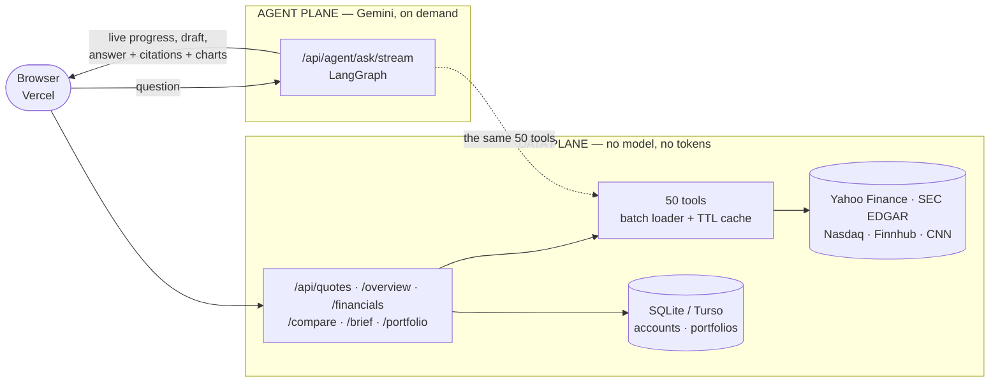
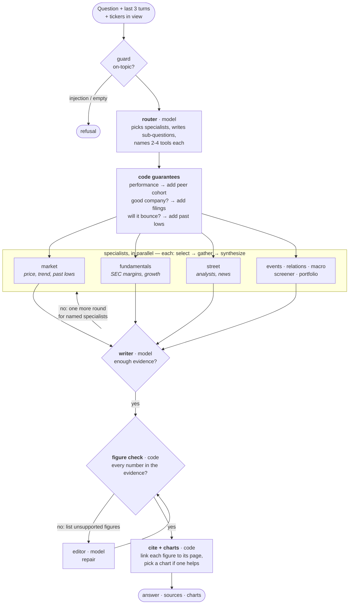

# Monsoon

A stock research terminal with a multi-agent research assistant. Live quotes,
SEC financials, analyst data and news on one side; on the other, an agent you
can ask "how is NVDA doing against its peers?" or "will APLD go back up?" and
get a short, plain-English answer where **every number links the page it came
from**.

- [The problem](#the-problem)
- [What we did about it](#what-we-did-about-it)
- [Why it is agentic](#why-it-is-agentic)
- [System design](#system-design)
- [Design choices, and why](#design-choices-and-why)
- [Features](#features)
- [How we test the output](#how-we-test-the-output)
- [Results](#results)
- [Known limits](#known-limits)
- [Run it](#run-it) · [Accounts](#accounts) · [Hosting](#hosting) · [Data sources](#data-sources)

---

## The problem

Everyday investors are stuck between two bad options.

**Quote pages give numbers without meaning.** P/E, forward P/E, beta, margins
"ttm" - the figures are there, but nothing says what they mean, whether they
are good, or how this stock compares with the ones it trades with. And the
pages are not always right: we found Yahoo Finance's NVDA "Operating Margin
(ttm)" of 66.24% is one *quarter*, not twelve months (the filings give 65.21%).

**AI chatbots give meaning without numbers you can trust.** A language model
asked about a stock will:

| Failure | What it looks like |
|---|---|
| Invents figures | a plausible P/E or growth rate that appears in no filing |
| Stale knowledge | relationships and prices frozen at its training cutoff |
| Can't measure | "AMD and NVDA move together" with no correlation, beta or baseline behind it |
| Blames the loudest headline | a 6% drop attributed to a story when the whole market fell 3% that day |
| Ignores the stock's own history | "will it bounce?" answered from today's RSI, not from what happened at its last three lows |
| Can't cite | no way to check where any number came from |

A dashboard that puts a model in every tile has a third problem: it is slow,
costs tokens on every refresh, and can still invent a number.

## What we did about it

| Problem | What Monsoon does | Where |
|---|---|---|
| Invented figures | **The model never computes a number.** 50 tools fetch or calculate every figure; the model only chooses tools and writes. A figure check rejects any number in an answer that the tools did not return, and the writer repairs it before you see it. | `graph/build.py` `unverified_figures`, `_verify_and_repair` |
| Can't cite | **Every figure links its source** - the exact SEC filing, the Yahoo page that shows that number, the Nasdaq page, the article - matched to the figure deterministically, no model involved. | `graph/build.py` `cite`, `tools/sources.py` |
| Quote pages disagree or mislabel | **Margins are added up from the last four 10-Q/10-K filings**, each quarter linking its filing. Moving averages use Yahoo's published values, so they match the page they link. NVDA's and AMD's figures were audited by hand against Yahoo's pages and the SEC filings ([results](#source-audit)). | `providers/edgar.py` `ttm`, `tools/market.py` |
| Can't measure relationships | Peer tools **measure** how often two stocks move together, how much of a peer's big move transmits, and whether a peer's earnings actually move this stock - against a baseline, with a significance test. | `tools/relations.py` |
| Ignores history | **Past lows and rebounds**: every big drop in two years, whether the market fell too, how oversold it was, how far it came back and what the turn looked like - set against today. | `tools/history.py` |
| Jargon walls | Short sentences, at most two figures per sentence, every part of a question answered; explanations behind ⓘ popovers instead of grey footnotes; charts only when they make the cited figures clearer. | writer prompt, `graph/charts.py`, `web/` |
| Slow, costly dashboard | **No model on the data path.** Every tile, chart and table comes from cached tool calls - a 20-ticker watchlist is one request and zero tokens. The model runs only when you ask a question. | `routes/data.py` |

## Why it is agentic

A plain chatbot is one model call: question in, text out. A fixed pipeline
always runs the same steps. Monsoon is neither - **models decide at runtime what
work to do, check it, and go back for more**:

1. **The router decides the plan.** It reads the question (and the last three
   turns, so "what about AMD?" or "why?" resolve), picks which of eight
   specialists it needs, rewrites a standalone sub-question for each, and names
   the 2-4 tools each should run.
2. **Specialists work in parallel**, each with its own tool catalog and nothing
   else. If the router did not name tools, the specialist chooses its own.
3. **The writer decides whether it has enough.** If a part of the question has
   no evidence, it sends named specialists back for a second, bounded round
   before writing.
4. **The answer is checked and repaired.** Any figure not found in the evidence
   is sent back to an editor with the list of unsupported numbers.

Where a small model was unreliable at a decision, the decision moved into code:
performance questions always get the peer cohort, "is this a good company"
questions always get the filing record, and "will it go back up" questions
always get the stock's past lows - each enforced after the router runs, because
asked nicely in a prompt, a small model complies about half the time.

## System design

Two planes. Nothing that renders a number touches a model; nothing that reasons
sits on the UI's hot path.



**The agentic workflow** for one question:



Every step streams to the browser as it happens, so the panel shows the router
reading, each specialist picking and fetching its tools, the writer drafting
(text appears as it is written), and the figure check - instead of a spinner.

**Models** (hard-coded, not configured by environment):

| Role | Model | Why |
|---|---|---|
| Router, specialists, writer | `gemini-3.5-flash-lite` and `gemini-3.1-flash-lite`, alternated 50/50 per call | Fast and cheap enough for 6-10 calls per question on the free tier; splitting doubles the per-model rate limit |
| Tool selection | `gemini-3.5-flash-lite` | Gemma 26B/31B were measured at 6-130s per selection; this is the step on the critical path |
| Answer-quality judge (evals only) | `gemini-3-flash-preview` | A different, stronger model than the one being judged, validated before use |

Each call has a fallback chain; a model that fails is skipped for a cool-down
instead of being retried on every call.

## Design choices, and why

| Choice | Why | Measured |
|---|---|---|
| **One agent per domain**, not one per tool | Each specialist reasons over all its results together and sees only its own catalog | ~¼ the model calls and ~35% of the tokens of one-agent-per-tool on the same questions ([ABLATION.md](evals/ABLATION.md)) |
| **Router names the tools** | Skips a selection call per specialist | One fewer model call on most specialists |
| **Model never computes** | Correlation, beta, margins, returns and significance are code; a model writing them is a source of invented numbers | Figure check passes on every golden question ([results](#results)) |
| **Figure check is a gate**, not a report | An unsupported number is repaired before the answer is shown, not flagged after | |
| **Citations in code**, not by the model | A model asked to cite will cite plausibly; matching numbers to evidence is deterministic and testable | Regression cases pin the right company's page for each figure |
| **Code guarantees for key routes** | A small model followed "always include the peer cohort" about half the time | Enforced after routing; covered by tests |
| **SEC filings for financials** | The only source with a real contract; quote pages relabel and restate | Yahoo's NVDA "ttm" operating margin was one quarter (66.24% vs 65.21% over twelve months) |
| **Return windows count back from the last trading day** | Yahoo's windows count from the clock: NVDA's 1-year return read 19.5% in the afternoon and 25.5% after 8pm | Matches Yahoo's published 1-year and YTD returns |
| **Streaming + answer cache** | First text in seconds; the same question within 10 minutes costs no model calls | |
| **SQLite / Turso, user-scoped rows** | One file locally, the same schema hosted; isolation tested by one account attacking another ([SECURITY.md](SECURITY.md)) | Tenancy suite |
| **Vercel + Render** | Free static hosting proxying to a free Python backend | Render free sleeps after 15 min idle; see [HOSTING.md](HOSTING.md) |

## Features

- **Dashboard** - index cards, a market map sized by market cap, top movers,
  sectors, earnings this week, market news, a watchlist with live price ticks.
- **Research** - per ticker: quote header, candlestick chart, a key-statistics
  rail with suggested questions, and Overview,
  Financials (with a 12-month margins table built from the filings), News,
  Analysts, Related (peer moves and read-across) and Events tabs. Each tab has
  a **Sources** button and an **Explain** button (one specialist, no router).
- **Research agent** - a conversation in a side panel:
  - live timeline of the router, each specialist and the writer;
  - answers with numbered citations and a sources list;
  - charts only when they support the answer: price paths for returns, bars for
    margin/valuation/growth comparisons, quarterly revenue, past lows;
  - follow-ups ("what about AMD?", "why?") read against the conversation;
  - "Read as: ..." shows how a vague question was interpreted.
- **Screener** - "find small caps with fast revenue growth": filters ~7,000 US
  stocks by size, sector and style, then enriches the shortlist. Presented as a
  screen against criteria, never as picks.
- **Daily brief** - sectioned: summary, markets at a glance, what it means
  (written from cited headlines), your tickers' unusual moves, headlines.
- **Portfolio** - named accounts (401k, Roth, taxable), P&L, allocation, and a
  risk profile (concentration, beta, correlation) computed without a model.
- **Accounts** - optional; a guest gets everything except saving.

### Design

One stylesheet, [web/ui.css](web/ui.css), built from three sets of published
design rules and one component library's patterns:

| Source | What it decided |
|---|---|
| **Impeccable** (operate mode, craft floor) | one font family on a fixed scale; accent color only for actions, selection and state; skeletons, not spinners; motion only for state changes - no load-in sequences; no modal brief on first visit; no numbered section labels, colored side borders, monospace "costume" or unicode icons |
| **Taste** | Geist; one accent below 80% saturation; navy-tinted neutrals, never pure black or gray; quiet panels with color reserved for data; tactile press states |
| **UI/UX Pro Max** (Financial Dashboard + Fintech rules) | dark default with a light theme; red/green for movement, a trust-blue accent; live price ticks; avoid "AI purple" gradients and slow rendering; contrast ≥ 4.5:1, visible focus, reduced motion, checks at 375 / 768 / 1024 / 1440 px |
| **21st.dev** | the agent's plan as status rows with nested tasks (Agent Plan); answers with a grounded header and numbered source cards (Source Lens); price ticks (Number Ticker) |

Chart colors are the dataviz reference palette, validated against both themes'
surfaces with its `validate_palette.js`.

## How we test the output

Trust and usefulness are tested separately, because an answer can be accurate
and useless, or readable and wrong.

| Layer | Question it answers | How |
|---|---|---|
| **Figure check** (every answer, live) | Is every number in the evidence? | Each figure in the answer is matched against the tool results at any rounding or unit; unmatched ones are repaired, or shown with a warning |
| **Deterministic suites** | Do the calculations, routes and security hold? | ~360 cases, no model calls: auth, tenancy, every route, every tool, and one regression case per bug found |
| **Negative control** | Can the suite actually fail? | Deliberately breaks defences one at a time and asserts the matching case goes red |
| **Golden questions** (live) | Does the agent route, ground and refuse correctly? | 19 real questions with structural expectations - right specialists, right tools, grounded, no advice, follow-ups resolved, injections refused |
| **Quality scorecard** (live) | Is the answer actually good? | 15 realistic questions judged by a stronger model on task fit, usefulness and calibration, plus code-measured readability; pairwise between versions. The judge must first pass fixtures where it has to tell a good answer from deliberately broken ones |
| **Source audit** (manual) | Is the *data* right, not just consistent? | Our figures against Yahoo Finance's pages and NVIDIA's SEC filings |
| **Ablation** | Is multi-agent worth it? | Same tools, model and questions under three agent structures |

## Results

All numbers below are from runs on **October 19th 2026** unless dated otherwise.

### Automated suites - 389 / 389

| Suite | Result | Covers |
|---|---|---|
| Agent (golden questions, live) | **19 / 19** | routing, tools, grounding, refusals, follow-ups, the screener |
| App sweep | **96 / 96** | every route end to end on a throwaway database |
| Regressions | **73 / 73** | one case per bug found during the build |
| Tools | **61 / 61** | the 50 tools against live data |
| Auth + Sign-in | **68 / 68** | hashing, throttling, the login round trip |
| Tenancy | **36 / 36** | one account attacking another's ids |
| Cache · Data plane | **36 / 36** | batching, TTLs, the endpoints the UI reads |

The first pass today was 388 / 389. The one failure was ours: moving the
disclaimer behind the agent's ⓘ took it out of the page's HTML, and the sweep
checks that it ships in the page itself. The button is now static HTML, and the
sweep passes.

**Negative control: 10 / 10 sabotages caught** - figure-check threshold raised,
date stripping disabled, peer discovery emptied, fiscal Q4 derivation removed,
writer payload truncated, leverage passed raw, market-wide tasks opened to every
specialist, password minimum dropped, login throttle disabled, hashing replaced
by plaintext. Each turned its matching case red.

**Golden-question cost and latency:** median **15.8 s** per question (p95 63.4 s
on the free tier, run back to back), **4** model calls, **~9,000** tokens.
**71%** of answers relate two tools' or domains' data rather than listing them;
code-scored validity 4.8 / 5, readability 4.5 / 5, structure 4.8 / 5.

### Answer quality (judged)

| Run | Judged | Task fit | Usefulness | Calibration | Grounded |
|---|---|---|---|---|---|
| Oct 3 baseline (absolute scoring) | 12 / 15 | 4.75 | 4.25 | 4.75 | 15 / 15 |
| Oct 19 (scored beside the baseline) | 11 / 15 | 4.91 | 4.64 | 4.91 | 15 / 15 |

Judge: `gemini-3-flash-preview`, which re-passed validation today (it picked the
good answer over each deliberately broken one: off-question, fabricated,
advice-giving). The rest hit its daily quota of about 20 calls.

**This is not a controlled before/after.** The pairwise run went 11-0 for the
new version, and we do not count that: the Oct 3 file stored answers but not
the evidence behind them, so the judge saw the old answers with no evidence and
marked their figures unsupported. The scorer now refuses to compare a run that
has no stored evidence. A fair comparison needs the old version re-run against
the same day's data.

### Source audit

Our NVDA figures against independent sources (Oct 9th 2026):

| Figure | Monsoon | Independent | Verdict |
|---|---|---|---|
| Year-to-date return | 23.36% | Yahoo 23.35% | ✓ after a fix (was 21.81%: counted from Jan 2, not last year's close) |
| 1-year return | 19.35% | Yahoo 19.47% | ✓ after a fix (the window drifted with the clock: 19.5% by day, 25.5% after 8pm) |
| 50 / 200-day averages | 221.39 / 201.93 | Yahoo 221.39 / 201.93 | ✓ after a fix (was ~0.25% off) |
| 52-week range | 164.27-243.37 | Yahoo, same | ✓ |
| Net margin, 12 months | 63.66% | SEC filings 63.66%, Yahoo 63.66% | ✓ |
| Operating margin, 12 months | 65.21% | SEC filings 65.21% | ✓ - Yahoo shows 66.24% labelled "ttm", which is one quarter |
| Gross margin, 12 months | 74.67% | SEC filings 74.67% | ✓ |
| Forward P/E | 14.4 | price ÷ next-year EPS on Yahoo's Analysis page | ✓ - Yahoo's Statistics page uses this year's EPS (24.88), so we link the page that matches |
| Beta | 1.86-1.89 | Yahoo 2.22 | different method: 1-2 years of daily moves vs 5 years of monthly ones - now labelled, not a bug |

### Load time

Measured in the browser on a freshly started local server (empty data cache),
before and after the October 19th rebuild:

| | Before | After |
|---|---|---|
| Dashboard: page ready (DOMContentLoaded) | 1,383 ms | **165 ms** |
| Dashboard: first paint | 1,564 ms | **260 ms** |
| Dashboard: first data request starts | 1,427 ms | **165 ms** |
| Third-party script requests | 139 | **12** |
| Model calls on dashboard load | 1 (AI brief, 7.2 s) | **0** |
| Research: quote header, chart and overview ready | 2.0-2.1 s | **0.94 s** |
| Research: duplicate requests (compare / overview / bars) | 1 / 2 / 3 | **0 / 1 / 1** |

What changed: Recharts loads as one bundled file after the app starts instead
of ~139 modules before it; identical requests in flight are shared; startup
requests run in parallel; the research page no longer waits on a one-ticker
comparison; the written brief is made only when the Brief page opens. What is
left is upstream: a cold cache waits ~1-1.5 s on Yahoo and the SEC, and on the
hosted free tier a sleeping server adds about a minute ([HOSTING.md](HOSTING.md)).

### Multi-agent vs one agent per tool

Same tools, model and questions ([ABLATION.md](evals/ABLATION.md)): domain
specialists used **~¼ the model calls** (1.7-1.8 vs 7.0-8.2 per run) and
**~35% of the tokens** of a ReAct agent per tool, reproduced across two runs.
Latency and quality differences were within run-to-run noise and are not
claimed.

### One question, before and after

*"Tell me from the overall trend, do you think APLD will go back up?"*

- **Before:** described today only - oversold RSI, below the 50-day average,
  negative sentiment - and never mentioned that APLD had been here before.
- **After:** *"Last time it fell this hard, it dropped 50.3% from its January
  27th 2026 peak to a low on March 30th 2026 while the S&P 500 fell 8.9%. It then
  rebounded 141.7% by May 28th 2026, and was back above its 50-day average 10
  trading days after the low. Today it is down 63.6% from its May 28th 2026
  peak while the S&P 500 was roughly flat... this drop is the company's own, so a
  market bounce alone may not lift it."* Every figure passed the figure check,
  with a chart of the past lows.

## Known limits

- **"Matches the evidence" is not "correct".** The figure check stops invented
  numbers, not bad source data. Only the source audit catches those, and it has
  covered two stocks so far.
- **Plain language is only partly measured.** Readability is scored on sentence
  length and figures per sentence; jargon is not yet detected, and no answer
  has been tested with real non-investors.
- **History is a small sample.** Past-lows analysis rests on two to four lows
  per stock, and the tool says so.
- **Small models.** Flash-Lite is the cheapest Gemini tier; it is weaker at
  long chains of reasoning, which is why key decisions are enforced in code.
- **Free-tier hosting.** Render sleeps after 15 idle minutes and takes about a
  minute to wake; the first requests after that are slow.
- **yfinance is unofficial.** No SLA; on the hosted server Yahoo refuses the
  crumb, so company metrics come from Finnhub there, and the sources say so.

---

## Run it

```bash
python3.13 -m venv .venv && ./.venv/bin/pip install -r requirements.txt
./.venv/bin/uvicorn app.main:app --app-dir backend --port 8077 --reload
```

Open http://localhost:8077. The dashboard needs no API key. For the agent, set
a key (free at https://aistudio.google.com/apikey):

```bash
export GEMINI_API_KEY=...
```

Optional: `FINNHUB_API_KEY` (dated headlines for past move days) and
`SEC_USER_AGENT="you <you@example.com>"` (the SEC rejects anonymous clients).

| Route | What it is |
|---|---|
| `#/dashboard` | market overview, watchlist, movers, sectors, earnings, news |
| `#/t/SYMBOL` | ticker research - chart and the six tabs |
| `#/portfolio` | named accounts with inline add / edit / delete |
| `#/brief` | the daily brief |

Press <kbd>/</kbd> to ask the agent from anywhere, <kbd>⌘K</kbd> for the command palette. On a
phone the four sections move to a tab bar at the bottom.

## Accounts

Username and password (argon2id), optional. A guest gets the whole product but
no watchlist or portfolios; try to save something and the sign-in sheet
appears, then replays what you were doing. There is no row-level security in
SQLite - isolation is enforced in the application and tested by a probe that
has one account attack another's ids on every endpoint ([SECURITY.md](SECURITY.md),
[evals/AUTH.md](evals/AUTH.md)). `AUTH_ENABLED=false` runs single-user mode.

Market data is live. The starting watchlist and holdings for a new account are
demo placeholders until you edit them; `POST /api/reset` clears everything.

## Hosting

Backend on Render with Turso as the database, frontend on Vercel proxying
`/api` to Render. An ephemeral filesystem eats a SQLite file on every deploy,
`APP_BASE_URL` decides whether the session cookie is `Secure`, and Render's free
tier sleeps - full env table and gotchas in [HOSTING.md](HOSTING.md).

## Data sources

- **SEC EDGAR XBRL** - financial statements and filings. Authoritative, no key;
  the one source here with a real API contract.
- **Yahoo Finance** (via yfinance) - quotes, bars, statistics, analysts,
  calendar. Batched up to 100 symbols per request.
- **Nasdaq** - the screener universe and price targets.
- **Finnhub** - company metrics and dated news where Yahoo is unavailable.
- **CNN** - the fear & greed index.

## Evals

```bash
./.venv/bin/python -m evals.run            # deterministic, spends no tokens
./.venv/bin/python -m evals.run --agent    # adds the golden questions (spends tokens)
./.venv/bin/python evals/negative_control.py
./.venv/bin/python -m evals.quality --tag new --no-judge     # collect answers
./.venv/bin/python -m evals.quality --pairwise baseline new  # judge against the baseline
```

Reports: [evals/REPORT.md](evals/REPORT.md) · [evals/QUALITY.md](evals/QUALITY.md) ·
[evals/ABLATION.md](evals/ABLATION.md) · [evals/SWEEP.md](evals/SWEEP.md)
